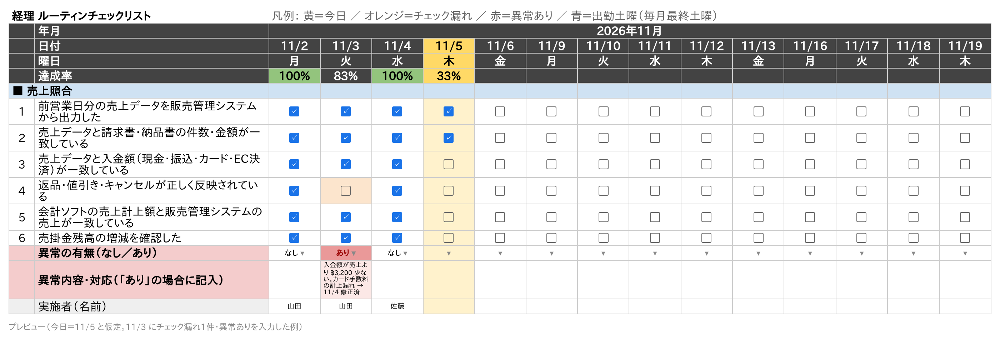

# ルーティンワーク定着チェックリスト（Google スプレッドシート）

従業員の毎日のルーティン作業をチェックするためのスプレッドシートを、Apps Script（`checklist.gs`）で自動作成します。

- 日付は**横方向**に並ぶ（**平日＋毎月の最終土曜日**。それ以外の土日は出ない）
- **部署ごとにシート**を分ける（初期は「経理」「物流」）
- チェック区分（例：売上照合）ごとに、チェック項目＋**異常の有無**＋**異常内容・対応**＋**実施者**の欄
- 経理シートには「売上照合」の区分が入った状態で作成。物流シートは空（項目はあとから追加）

## シートの見た目

| | 11/2 月 | 11/3 火 | … | 11/28 土(出勤) | … |
|---|---|---|---|---|---|
| **達成率** | 100% | 83% | | | |
| **■ 売上照合** | | | | | |
| 1 前営業日分の売上データを出力した | ☑ | ☑ | | ☐ | |
| 2 売上データと請求書・納品書の件数・金額が一致している | ☑ | ☐ | | ☐ | |
| … | | | | | |
| **異常の有無（なし／あり）** | なし | あり | | ▾ | |
| **異常内容・対応** | | 入金額が売上より少ない… | | | |
| 実施者（名前） | 山田 | 佐藤 | | | |

色の意味：

- 黄：今日の列
- オレンジ：過去の日のチェック漏れ・「異常の有無」の未記入
- 赤：異常あり（「異常内容・対応」に書かれたセルも薄い赤）
- 青：出勤する土曜日（毎月の最終土曜日）
- 緑：達成率 100%

見出し（年月・日付・曜日・達成率）とチェック項目の列は固定なので、横にスクロールしても見えたままです。

## 導入手順（初回のみ・5分）

1. Google ドライブで**新しいスプレッドシート**を作成（名前は例：「ルーティンチェックリスト」）
2. メニューの **拡張機能 → Apps Script** を開く
3. `コード.gs` の中身をすべて消し、`checklist.gs` の中身を貼り付けて **保存**（💾）
4. 上の関数の選択欄で **`setupChecklist`** を選び **実行**
   - 初回は「承認が必要です」と出るので、自分のアカウントを選んで許可（「詳細」→「（安全ではないページ）に移動」→「許可」）
5. スプレッドシートに戻ると「経理」「物流」シートができています。**ページを再読み込み**すると、上部に「**チェックリスト**」メニューが出ます

開始月（初期値：2026年11月から3か月分）を変えたいときは、手順4の前に `checklist.gs` 冒頭の `CONFIG` の `startYear` / `startMonth` / `initialMonths` を書き換えてください。

## 毎日の使い方

1. メニュー **チェックリスト → 今日の列へ移動**
2. 作業が終わった項目のチェックボックスにチェック
3. 「異常の有無」で **なし／あり** を選ぶ
4. **あり** のときは「異常内容・対応」に内容（何が・いくら違ったか、原因、対応、報告先など）を書く
   - 文字が多いときは、そのセルをダブルクリックすると全文を入力・確認できます
5. 「実施者」に名前を書く

## チェック項目を増やす

| やりたいこと | 操作 |
|---|---|
| 既存の区分に項目を追加 | 区分内の行（どれでも）を選択 → **チェックリスト → チェック項目を追加** |
| 新しい区分を追加（例：買掛照合、出荷前チェック） | そのシートを開いて **チェックリスト → チェック区分を追加** → 区分名、項目を「／」区切りで入力 |
| 部署を増やす | **チェックリスト → 部署シートを追加** |
| 項目名を変える | C列の文字をそのまま書き換える |
| 項目を削除 | 行を右クリック → 行を削除（番号は手で振り直してください） |

> ※ 行を手で挿入して項目名を書いた場合も、翌月分を追加すると新しい日付にはチェックボックスが付きます。すでにある日付の列にチェックボックスを付けたいときは、上の行のチェックボックスをコピーして貼り付けてください。

## 日付を先に延ばす

- **チェックリスト → 翌月分の日付を追加**：全シートに1か月分の列を追加
- **チェックリスト → 翌月分を毎月自動で追加する**：毎月20日の朝に、翌月分がまだ無ければ自動で追加（1回設定すればOK）

## 祝日・臨時休業

土日以外の休み（祝日など）は自動では除外していません。その日の列を右クリック → **列を削除** してください。

## 注意

- **初期セットアップ（シートを作り直す）** を実行すると「経理」「物流」シートは作り直され、入力済みのチェックは消えます（実行前に確認が出ます）
- A列は内部用（行の種類）なので非表示にしています。消さないでください
