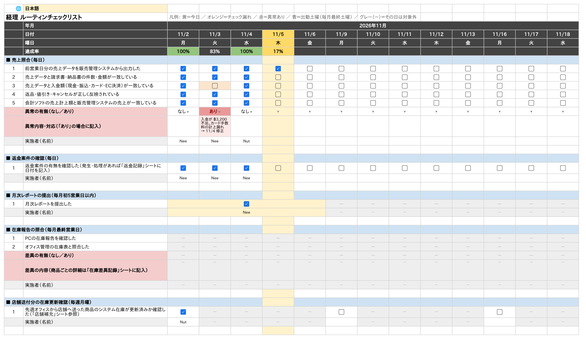
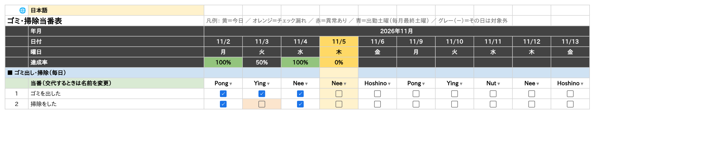
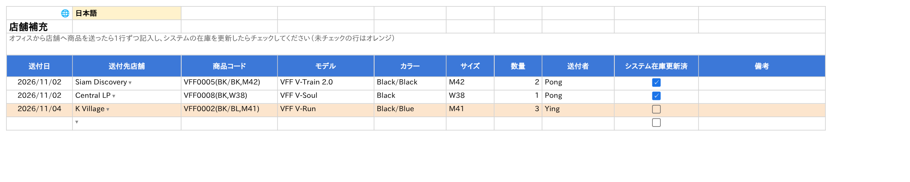
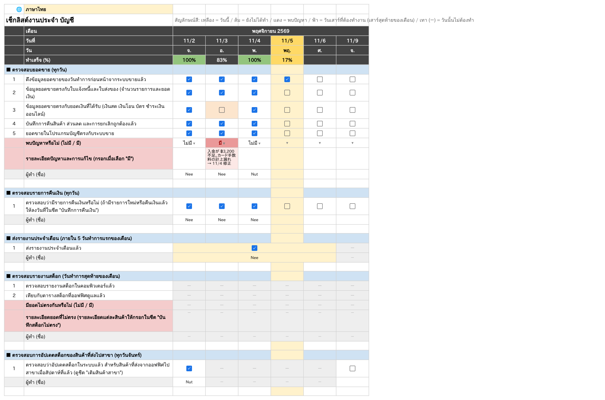

# ルーティンワーク定着チェックリスト（Google スプレッドシート）

従業員の毎日のルーティン作業をチェックするためのスプレッドシートを、Apps Script（`checklist.gs`）で自動作成します。
表示は **日本語／English／ไทย** を切り替えられます。

## できるシート

| シート | 種類 | 内容 |
|---|---|---|
| **経理** | チェックリスト | 売上照合（毎日）／返金案件の確認（毎日）／月次レポートの提出（毎月初5営業日以内）／在庫報告の照合（毎月最終営業日）／店舗送付分の在庫更新確認（毎週月曜） |
| 返金記録 | 記録 | 返金案件ごとに 発生日・処理日・注文番号・金額・返金方法など（処理日が空欄＝未処理はオレンジ） |
| 在庫差異記録 | 記録 | 月末の在庫照合で差異があった商品ごとに PC在庫数・在庫表の数・差異（自動計算）・原因・対応 |
| **オフィス倉庫** | チェックリスト | 発送完了（毎日・14時締め後）／店舗在庫・補充の確認（毎週月曜）／オンライン発送分の店舗在庫調整（毎週月曜） |
| 店舗補充 | 記録 | どの店舗に・いつ・何を・いくつ送ったか＋システム在庫を更新したか |
| オンライン発送 | 記録 | 週末に店舗から発送したオンライン注文の 日付・発送元店舗・商品＋店舗在庫を調整したか |
| **ゴミ・掃除当番** | 当番表 | 出勤日ごとに Pong → Ying → Nut → Nee → Hoshino の順で交代。ゴミ出し・掃除をチェック |
| 翻訳 | 設定 | 日本語・英語・タイ語の対訳表（ここを直すと表示も変わる） |

### チェックリスト（経理・オフィス倉庫・ゴミ・掃除当番）

- 日付は**横方向**に並びます（**平日＋毎月の最終土曜日**。それ以外の土日は出ません）
- 項目ごとにチェックする日が決まっています。対象外の日は **グレーの「－」**
  - 毎日：毎出勤日
  - 毎週月曜：その週の最初の出勤日（通常は月曜）
  - 毎月最終営業日：その月の最後の出勤日（最終土曜が最後ならその日）
  - 毎月初5営業日以内：月初の5営業日を**1マスに結合**。提出した日にチェック（5営業日目を過ぎても未チェックならオレンジ）
- 「異常の有無」「差異の有無」で **あり** を選ぶと赤くなり、下の欄に内容を書けます
- 色：黄＝今日／オレンジ＝チェック漏れ・未記入／赤＝異常あり／青＝出勤土曜／緑＝その日の達成率100%
- 見出し（日付・曜日・達成率）と項目名の列は固定。横にスクロールしても見えたままです

### ゴミ・掃除当番

- 当番は出勤日ごとに自動で交代します（日付を追加しても順番が続きます）
- 休み・交代のときは、その日の名前をプルダウンで別の人に変えてください（以降の順番は変わりません）
- スタッフを増やす・順番を変えるときは `checklist.gs` 冒頭の `STAFF` を書き換えて「初期セットアップ」を実行

### 記録シート（返金記録・在庫差異記録・店舗補充・オンライン発送）

- 1件1行で記入。日付の欄はダブルクリックでカレンダーから選べます
- 店舗は**プルダウン**（K Village／Central CL (Department)／Siam Discovery／Paradise Park／Central LP／Event Asok。一覧にない店舗も手入力できます）
- 処理・更新がまだの行はオレンジ。見出しの ▼ フィルターで店舗別・日付別に絞り込めます
- チェックリスト側の項目（「返金記録シートに記入」「店舗補充シート参照」など）とつながっています

## 言語の切り替え（日本語／English／ไทย）

- 各シートの**左上の黄色いセル（🌐）**のプルダウンで言語を選ぶと、**全シート**の見出し・項目・選択肢・シート名・メニューが切り替わります
  - メニュー **✅ Checklist → 🌐 言語 / Language / ภาษา** からも切り替えられます
  - 表示はスプレッドシート全体で共通です（ある人が切り替えると、他の人の画面も同じ言語になります）
- 入力した内容（名前・異常内容・備考など）は翻訳されません
- タイ語の年月は仏暦（例：พฤศจิกายน 2569）で表示します
- **訳語を直したいとき**：「翻訳」シートの該当セルを書き換えると、シートの表示もすぐ変わります
- メニューから項目を追加したときは、英語・タイ語を Google 翻訳で自動登録します（「翻訳」シートで黄色の行＝要確認）。必要に応じて直してください

> 英語・タイ語の訳はなるべく短く自然な言い回しにしていますが、運用前にタイ人スタッフに一度目を通してもらうことをおすすめします。

## 導入手順（初回のみ・5分）

1. Google ドライブで**新しいスプレッドシート**を作成
2. メニューの **拡張機能 → Apps Script** を開く
3. `コード.gs` の中身をすべて消し、`checklist.gs` の中身を貼り付けて **保存**（💾）
4. 上の関数の選択欄で **`setupChecklist`** を選び **実行**
   - 初回は「承認が必要です」と出るので、自分のアカウントを選んで許可（「詳細」→「（安全ではないページ）に移動」→「許可」）
5. スプレッドシートに戻って**再読み込み**すると、上部に「**✅ Checklist**」メニューが出ます

開始月（初期値：2026年11月から3か月分）は `checklist.gs` 冒頭の `CONFIG` で変えられます。

**前のバージョンを使っていた場合**：Apps Script の中身を新しい `checklist.gs` に貼り替えて保存し、メニュー（または `setupChecklist`）で **初期セットアップ** を実行してください。古い「経理」「物流」シートは削除され、新しい構成で作り直されます（入力済みの内容は消えます）。

## 毎日の使い方

1. **✅ Checklist → 今日の列へ移動**
2. 終わった項目にチェック（グレーの「－」の日は何もしなくてOK）
3. 「異常の有無」で なし／あり を選び、ありなら内容を書く
4. 「実施者」に名前を書く
5. 返金・店舗への送付・週末のオンライン発送・在庫差異があったら、それぞれの記録シートに1行追加

## 項目を増やす

| やりたいこと | 操作 |
|---|---|
| 既存の区分に項目を追加 | 区分内の行（どれでも）を選択 → **✅ Checklist → チェック項目を追加**（頻度は区分と同じ） |
| 新しい区分を追加 | そのシートを開いて **✅ Checklist → チェック区分を追加** → 区分名、頻度（1〜4）、項目を「／」区切りで入力 |
| 部署を増やす | **✅ Checklist → 部署シートを追加** |
| 項目名を変える | 「翻訳」シートで書き換える（3言語とも変えられる）。C列を直接書き換えると、その言語でしか表示されません |
| 項目を削除 | 行を右クリック → 行を削除 |

## 日付を先に延ばす

- **✅ Checklist → 翌月分の日付を追加**：チェックリストの全シートに1か月分を追加
- **✅ Checklist → 翌月分を毎月自動で追加する**：毎月20日の朝に、翌月分がまだ無ければ自動で追加（1回設定すればOK）

## 祝日・臨時休業

土日以外の休み（タイの祝日など）は自動では除外していません。その日の列を右クリック → **列を削除** してください。
（列を削除する前に追加した月は「毎週月曜」「月初5営業日」の位置がそのままなので、祝日の多い月は、日付を追加した直後に休みの列を削除するのがおすすめです）

## 注意

- **初期セットアップ** を実行すると、チェックリストと記録シートはすべて作り直され、入力済みの内容は消えます（実行前に確認が出ます）。「翻訳」シートで追加した訳は残ります
- チェックリストのA列は内部用（行の種類）なので非表示にしています。消さないでください
